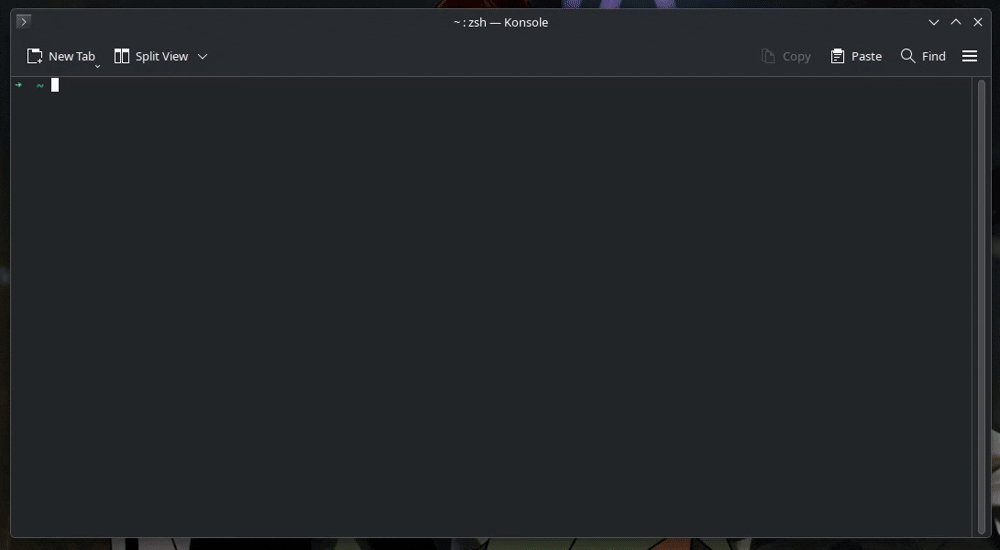

<p align="center">
  
</p>

<h1 align="center">Migurdex</h1>

<p align="center">
  <a href="https://github.com/roxyrekt/Migurdex/releases"></a>
  <a href="https://discord.gg/7eh3Qd7MJt"></a>
  <a href="LICENSE"></a>
  <a href="https://github.com/roxyrekt/Migurdex/actions/workflows/nightly.yml"></a>
  
  
</p>

Türkçe anime sağlayıcılarında arama yapıp bölümleri terminalden izlemene veya indirmene yarayan araç.
Arayüzü TUI, arka planda yerel bir HTTP API, ağ katmanı Rust, oynatıcı MPV.

*Search Turkish anime providers and watch episodes from your terminal.*



**Linux:**

```bash
curl -fsSL https://raw.githubusercontent.com/roxyrekt/Migurdex/main/install.sh | bash
```

**Windows (PowerShell):**

```powershell
irm https://raw.githubusercontent.com/roxyrekt/Migurdex/main/install.ps1 | iex
```

Kaldırma, AppImage ve elle kurulum için [Kurulum](#kurulum).

## Özellikler

- 15 sağlayıcıda arama; sonuç listesinde fuzzy filtre (`opc` → One Piece sonucunu bulur)
- AniList ve MAL: bilgi, alternatif başlık, sezon/bölüm eşleştirme ve izleme durumu senkronu
- MPV ile kaldığın yerden devam
- İndirme: MP4 ve HLS (`yt-dlp` + `ffmpeg`)
- Otomatik kaynak seçimi (sunucu / kalite / tür kuralları), uymazsa manuel liste
- Kaynak listesinde bitrate, codec, boyut ve süre; kaliteye göre renklendirme
- Geçmiş, favoriler, arama geçmişi
- Discord RPC, gizli mod
- Sağlayıcı açma/kapama ve sıralama öncelikleri

## Sağlayıcılar

| | | |
|:--|:--|:--|
|  Acheriya |  AniHub |  AnimeciX |
|  Animexe |  Animim |  AnimPow |
|  Anizium |  Anizm |  AsyaAnimeleri |
|  ÇizgiMax |  OpenAnime |  SonAnime |
|  TRAnimeci |  TrAnimeIzle |  TurkAnime (arşiv) |

TurkAnime sağlayıcısı kapanan sitenin temizlenmiş arşivini canlı Turso üzerinden sorgular. Ham SQLite:
[roxyrekt/turkanime-db](https://huggingface.co/datasets/roxyrekt/turkanime-db/blob/main/turkanime-v1.db).

## Kurulum

**Linux:**

```bash
curl -fsSL https://raw.githubusercontent.com/roxyrekt/Migurdex/main/install.sh | bash
```

**Windows (PowerShell):**

```powershell
irm https://raw.githubusercontent.com/roxyrekt/Migurdex/main/install.ps1 | iex
```

Sonra `migurdex` yaz. API arka planda kendisi başlar.

Kaldırma:

```bash
# Linux — programı siler, ayarlar/geçmiş korunur
curl -fsSL https://raw.githubusercontent.com/roxyrekt/Migurdex/main/install.sh | bash -s -- --uninstall

# Linux — program + ayarlar + geçmiş + veritabanı, hepsi silinir
curl -fsSL https://raw.githubusercontent.com/roxyrekt/Migurdex/main/install.sh | bash -s -- --purge
```

```powershell
# Windows — programı siler, ayarlar/geçmiş korunur
irm https://raw.githubusercontent.com/roxyrekt/Migurdex/main/install.ps1 | % { & ([scriptblock]::Create($_)) -Uninstall }

# Windows — program + ayarlar + geçmiş + veritabanı, hepsi silinir
irm https://raw.githubusercontent.com/roxyrekt/Migurdex/main/install.ps1 | % { & ([scriptblock]::Create($_)) -Purge }
```

### Elle kurulum

[Releases](https://github.com/roxyrekt/Migurdex/releases) sayfasından platformunun paketini indir:

| Platform | Arşiv | AppImage |
|---|---|---|
| Linux x86_64 | `migurdex-linux-x64.tar.gz` | `migurdex-x86_64.AppImage` |
| Linux aarch64 | `migurdex-linux-arm64.tar.gz` | `migurdex-aarch64.AppImage` |
| Windows x64 | `migurdex-win-x64.tar.gz` | — |

`.tar.gz` tek arşiv formatı: Linux, macOS ve Windows 10+ sistem `tar`'ı ile açılır. Paket CLI'yi `cli/`
altına, API'yi `api/` altına açar; paylaşılan .NET dosyaları **hardlink** olduğu için diskte tek kopya
kalır (≈129 MB). Yanında tek bir `sha256sums.txt` yayınlanır.

Windows'ta ek olarak `migurdex-win-x64.zip` de yayınlanır: v1.17.0 ve öncesi istemciler yalnızca zip
tanıdığı için otomatik güncelleyemiyor. Zip hardlink taşımadığı için daha büyüktür (≈91 MB) ve bir
sonraki sürümde kaldırılacaktır. Yeni kurulumlarda `tar.gz` kullan.

AppImage:

```bash
chmod +x migurdex-x86_64.AppImage
./migurdex-x86_64.AppImage
```

## Gereksinimler

- [MPV](https://mpv.io/) — PATH'te olmalı
- HLS indirmek için [yt-dlp](https://github.com/yt-dlp/yt-dlp); birleştirme için [ffmpeg](https://ffmpeg.org/).
  MP4 indirme bu araçlara ihtiyaç duymaz.
- AppImage için `libfuse2`
- Kaynaktan derlemek için .NET 10 SDK + Rust/cargo

Windows'ta eksik araçları Migurdex açılışta kurmayı önerir; elle `migurdex deps install` de çalıştırılabilir.
Kurulanlar SHA-256 ile doğrulanır ve `~/.config/migurdex/tools/` altına yazılır. Linux/macOS'ta otomatik
kurulum yok; araçları paket yöneticinle kur (`migurdex deps` durumu gösterir).

## Kullanım

Akış: **Ara → Detay → Bölüm → Oynat / İndir**. `Esc` bir ekran geri döner, yön tuşları + `Enter` ile gezinilir.

### Komut satırı

Menüye girmeden doğrudan işlem yapmak için:

```bash
migurdex search "one piece"                  # sağlayıcı | başlık | id
migurdex search "naruto" -p TurkAnime --json
migurdex play "one piece" -e 12
migurdex play "naruto" -s 2 -p TurkAnime -g FansubAdı
migurdex play "bleach" --debug               # mpv açmadan çözülen kaynağı yazdır
migurdex continue                            # kaldığın yerden devam

migurdex download "one piece" -e 12
migurdex download "naruto" -s 2 -p TurkAnime -g FansubAdı -o ~/Videos/Anime
migurdex download "bleach" -e 1 --format hls --force --no-resume
migurdex download "bleach" -e 1 --format mp4 --no-subs
migurdex download "bleach" -e 1 --json       # stdout yalnız JSON

migurdex blame                                # kaynak çözümleme süre ve hata dökümü
migurdex solve <sayfa-url>                    # Cloudflare Turnstile çöz, cf_clearance sakla
migurdex auth status                          # AniList / MAL bağlantı durumu
migurdex auth login anilist                   # bağlan (login mal)
migurdex auth logout all                      # tokenları sil (anilist | mal | all)
migurdex deps                                 # MPV, yt-dlp, ffmpeg durumu
migurdex deps install                         # eksikleri kur (Windows)
migurdex deps install yt-dlp --force          # seçili aracı yeniden kur
migurdex deps update                          # güncellemesi olan araçları kur
migurdex deps update --check                  # sadece kontrol et
migurdex update                               # yeni sürümü kur
migurdex --version                            # kurulu sürüm
```

`download` yalnız API'nin çözdüğü doğrudan `MP4` ve `M3U8/HLS` kaynaklarını kullanır; `Embed` ve `Unknown`
kaynaklar indirilmez. `auto` mevcut kalite/biçim tercihlerine ve seçim kurallarına uyar. `--force` hedefi
değiştirir, `--no-resume` kısmi dosyadan devam etmez. `--json` modunda stdout yalnız JSON, ilerleme stderr'e
gider. Çıkış kodları: `0` başarı, `1` çalışma zamanı/upstream hatası, `2` kullanım hatası, `3` video indi ama
altyazı aşaması kullanıcı tarafından iptal edildi.

Dosyalar `<çıktı>/<anime>/SxxEyy - <bölüm>.<uzantı>` düzeninde yazılır; altyazılar medyanın yanına ayrı
`.srt` / `.ass` / `.vtt` dosyası olarak kaydedilir. Varsayılan çıktı kökü platformun Downloads klasörü
altındaki `Migurdex` dizinidir.

### Güncelleme

Açılışta yeni sürüm varsa sorulur (`Evet, güncelle / Hayır / Bu sürümü atla`).

```bash
migurdex update                        # onaylı kurar ve yeniden başlatır
migurdex update --no-restart           # kurar, yeniden başlatmaz
migurdex update --check                # sadece kontrol
migurdex update --yes                  # sormadan kur (-y)
migurdex update --channel nightly      # bu seferlik etiketsiz main derlemesi
migurdex --no-update-check             # kontrolü bu açılışta atla
migurdex --no-dep-check                # araç güncelleme kontrolünü de atla
```

Kanal ve otomatik kontrol Ayarlar menüsünden değiştirilir (`stable` / `prerelease` / `nightly`). Ayarlar ve
geçmiş `~/.config/migurdex/` altında durur, güncelleme bunlara dokunmaz.

Güncelleme **delta** ile iner: sunucudaki `migurdex-<platform>.delta.tar` dosyasından iki Range isteğiyle
(512 B tar header + manifest) değişenler öğrenilir, ardından yalnız değişen blob'lar indirilir. Delta
uygulanamazsa tam arşive düşülür.

## Ayarlar

Ayarlar menüsünden: otomatik oynat, bekleme süresi, Discord RPC ve başlık modu, gizli mod, oynatıcı logları,
API adresi, AniList/MAL bağlantısı, sağlayıcı açma-kapama ve sıralama, otomatik seçim kuralları, araç durumu.
`Esc` / İptal ile çıkarsan değişiklikler uygulanmaz.

`config.json` üzerinden de değiştirilebilen indirme ayarları: `DownloadDirectory`, `YtDlpPath`,
`DownloadSubtitles`, `DownloadResume`, `DownloadOverwrite`, `AutoDownloadBestSource`,
`DownloadAutoSelectTimeoutSeconds`. Eski config dosyaları yeni alanlar yoksa da sorunsuz yüklenir.

## Güvenlik

İndirme yalnız API'nin verdiği doğrudan medya URL'lerini kullanır; gömülü oynatıcı sayfaları ve `Unknown`
kaynaklar otomatik indirilmez. Yalnız HTTP/HTTPS kullanılır ve farklı origin'e yönlenirken
`Authorization`/`Cookie` gibi başlıklar düşürülür. `--debug` çıktısı URL, header veya token yazdırmaz.

Yalnız erişim ve indirme iznin olan içerikleri kaydet.

## Dosyalar

Tüm platformlarda `~/.config/migurdex/` (`%USERPROFILE%\.config\migurdex\`).

`migurdex.db` (SQLite: geçmiş, favoriler, arama, tokenlar, eşleştirmeler), `config.json`, `logs/api.log`,
Windows'ta kurulan araçlar `tools/` altında.

## Mimari

| Proje | Görev |
|---|---|
| `Migurdex.Cli` | Terminal arayüzü, komutlar, indirme, MPV |
| `Migurdex.Api` | Yerel HTTP API: arama, detay, kaynak çözümleme |
| `Migurdex.Core` | Plugin yükleyici, Rust köprüsü, extractor'lar, veritabanı |
| `Migurdex.Shared` | Modeller ve arayüzler (`IAnimeProvider`, `IExtractor`) |
| `Migurdex.Native` | Rust ağ katmanı (`libmigurdex_native.so` / `migurdex_native.dll`) |
| `Plugins/` | Sağlayıcılar (`Migurdex.Plugins.*`) |

Akış: `TUI/CLI → API → plugin (+ Rust HTTP) → kaynak listesi → MPV veya indirici`.

Her plugin kendi `AssemblyLoadContext`'inde yüklenir; API çalışırken yeni plugin bırakılırsa yeniden yüklenir.
Native kütüphane API ile birlikte gelir, eksikse API başlamaz.

## Extractor'lar

Sağlayıcı plugin'leri sayfayı bulur; asıl video linkini `Migurdex.Core/Extractors` altındaki 39 yerleşik extractor çözer. `POST /api/v1/extractors/resolve` bunları dışarıya açar.

**Built-in extractor'lar**

<table>
  <tr><td>Abyss</td><td>AitrVip</td><td>AnizmPlayer</td><td>Byse</td><td>Cyberfile</td></tr>
  <tr><td>Dailymotion</td><td>DoodStream</td><td>Firestream</td><td>Flyfile</td><td>Gofile</td></tr>
  <tr><td>GoogleDrive</td><td>HdVid</td><td>HexUpload</td><td>MailRu</td><td>M3U8Playlist</td></tr>
  <tr><td>MixDrop</td><td>Mp4Upload</td><td>OkRu</td><td>Puffy</td><td>Rumble</td></tr>
  <tr><td>Sendvid</td><td>Sibnet</td><td>Sistenn</td><td>Streamain</td><td>Streamcash</td></tr>
  <tr><td>Streamtape</td><td>StreamWish</td><td>TauVideo</td><td>Turkanime</td><td>Upbolt</td></tr>
  <tr><td>Uqload</td><td>Videa</td><td>Vidmoly</td><td>VidsSt</td><td>Vidsonic</td></tr>
  <tr><td>Vk</td><td>Voe</td><td>YandexDisk</td><td>YourUpload</td><td></td></tr>
</table>

<details>
<summary><b>Hangi extractor hangi host'u çözüyor (39)</b></summary>

| Extractor | Çözdüğü host |
|---|---|
| Abyss | `abyss.to`, `abysscdn.com`, `abyssplayer.com`, `iamcdn.net` |
| AitrVip | `optraco.top` |
| AnizmPlayer | `anizmplayer.com` |
| Byse | `byse.net`, `bysesayeveum.com`, `bysesukior.com`, `filemoon.sx` |
| Cyberfile | `cyberfile.me` |
| Dailymotion | `dailymotion.com` |
| DoodStream | `doodstream.com`, `dood.to/.so/.la/.ws/.pm/.wf/.cx/.sh/.re/.watch`, `vide0`, `playmogo.com` |
| Firestream | `firestream.*` |
| Flyfile | `flyfile.app`, `flyfile.io` |
| Gofile | `gofile.io` |
| GoogleDrive | `drive.google.com`, `docs.google.com` |
| HdVid | `hdvid.tv` |
| HexUpload | `hexupload.com`, `hexload.com` |
| MailRu | `my.mail.ru` |
| M3U8Playlist | herhangi bir `.m3u8` / `.txt` |
| MixDrop | `mixdrop.*`, `miixdrop.*` |
| Mp4Upload | `mp4upload.com` |
| OkRu | `ok.ru`, `odnoklassniki.ru` |
| Puffy | `puffytr.tr` |
| Rumble | `rumble.com` |
| Sendvid | `sendvid.com` |
| Sibnet | `sibnet.ru` |
| Sistenn | `uns.bio`, `upns.one`, `rpmvid`, `strp2p` |
| Streamain | `streamain.com` |
| Streamcash | `streamcash.*` |
| Streamtape | `streamtape.com`, `streamtape.to`, `stape.com` |
| StreamWish | 30 domain (`streamwish.com`, `embedwish.com`, `vidcloud.top`, `hglink.to`, …) |
| TauVideo | `tau-video.xyz` |
| Turkanime | `turkanime.tv/player/` |
| Upbolt | `upbolt.*` |
| Uqload | `uqload.*` |
| Videa | `videa.hu` |
| Vidmoly | `vidmoly.*` |
| VidsSt | `vids.st` |
| Vidsonic | `vidsonic.net` |
| Vk | `vk.com`, `vkvideo.ru` |
| Voe | `voe.sx` |
| YandexDisk | `yadi.sk`, `disk.yandex.*` |
| YourUpload | `yourupload.com` |

</details>

Yeni bir host eklemek için `IExtractor` uygulayan bir sınıf yazmak yeterli: `AddCoreExtractors()` assembly'yi tarayıp tüm `IExtractor` sınıflarını kendisi kaydediyor, elle kayıt gerekmiyor.

## Derleme

```bash
./build.sh              # debug
./build.sh --release
./build.sh --publish    # dist/ altına paket
```

```powershell
.\build.ps1
.\build.ps1 -Release
.\build.ps1 -Publish
```

Geliştirirken tek komut yeter — CLI, API çalışmıyorsa kendisi başlatıyor (hem TUI hem non-interactive komutlar):

```bash
dotnet run --project Migurdex.Cli
```

API'yi ayrı çalıştırmak istersen (log görmek, `curl` ile denemek için): `dotnet run --project Migurdex.Api`

Testler: `dotnet test`. Smoke testleri canlı sitelere gider, ayrı workflow'da günlük çalışır.

## Topluluk

Soru, öneri ve OpenAnime altyazı anahtarı için Discord:

<p align="center">
  <a href="https://discord.gg/7eh3Qd7MJt">
    
  </a>
</p>

---

GPL-3.0. Detay için [LICENSE](LICENSE).
